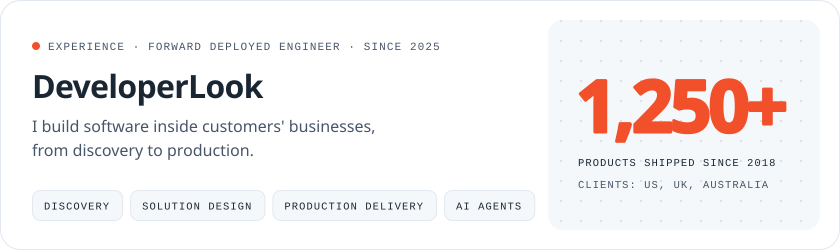
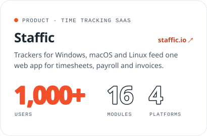
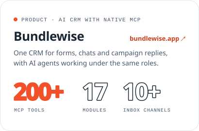
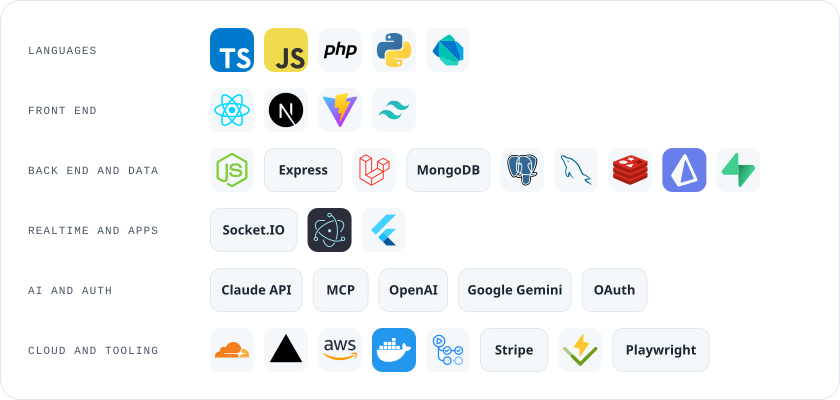
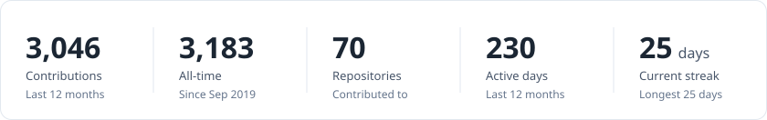

<!-- Charts below are regenerated daily by .github/workflows/profile-stats.yml -->

<a href="https://www.linkedin.com/in/saimulislamdl">
  <picture>
    <source media="(prefers-color-scheme: dark)" srcset="assets/hero-dark.svg">
    
  </picture>
</a>

  
  
  
  

## About

**Open to Forward Deployed Engineer and Solutions Architect roles.** I'm based in Kuala Lumpur (UTC+8) and work remote or on site.

I build software inside customers' businesses and stay until it works. For 10+ years I've built AI, automation and full-stack systems for teams in the US, UK and Australia. I start with the people who do the work, design the solution with them, then ship it to production.

I've been at DeveloperLook since 2018, first as a full-stack developer, then as senior full-stack developer and lead developer, and now as a forward deployed engineer. I architected Staffic there and built MCP servers for products like Sitessa and Bundlewise.

## Experience

<a href="https://developerlook.com"><picture><source media="(prefers-color-scheme: dark)" srcset="assets/card-developerlook-dark.svg"></picture></a>

**Full-Stack Developer, Senior Full-Stack Developer, Lead Developer, then Forward Deployed Engineer, [DeveloperLook](https://developerlook.com)** · 2018 to now

- **Customer-facing engineering.** I build AI agents, MCP servers and automation inside customers' operations.
- **Discovery and solution design.** I scope, design and price systems with customers in the US, UK and Australia.
- **Production delivery.** DeveloperLook has shipped 1,250+ products for 668+ clients since 2018.
- **Product architecture.** I architected Staffic, DeveloperLook's time tracking SaaS, from the desktop tracker to the web app.

## Products I built

  <a href="https://staffic.io"><picture><source media="(prefers-color-scheme: dark)" srcset="assets/card-staffic-dark.svg"></picture></a>
  <a href="https://bundlewise.app"><picture><source media="(prefers-color-scheme: dark)" srcset="assets/card-bundlewise-dark.svg"></picture></a>

- **[Staffic](https://staffic.io)**, time tracking SaaS used by 1,000+ people. I built the Electron tracker with idle detection and offline sync, the web app for timesheets, payroll and invoices, and Staffic AI on Claude with its own MCP server.
- **[Bundlewise](https://bundlewise.app)**, an AI CRM with native MCP. I built a multi-tenant data model that checks companies, workspaces and roles on every request, and an MCP server with OAuth, so Claude, ChatGPT and Cursor work with live data under the user's role.

## Tech stack

<picture>
  <source media="(prefers-color-scheme: dark)" srcset="assets/stack-dark.svg">
  
</picture>

## GitHub activity

Most of my work lives in private customer repositories. A GitHub Action in this repo builds these charts from my full activity and refreshes them daily. They show totals only: no private code, project or customer names.

<picture>
  <source media="(prefers-color-scheme: dark)" srcset="https://raw.githubusercontent.com/saimulft/saimulft/output/overview-dark.svg">
  
</picture>

<picture>
  <source media="(prefers-color-scheme: dark)" srcset="https://raw.githubusercontent.com/saimulft/saimulft/output/activity-dark.svg">
  
</picture>

  <picture><source media="(prefers-color-scheme: dark)" srcset="https://raw.githubusercontent.com/saimulft/saimulft/output/languages-dark.svg"></picture>
  <picture><source media="(prefers-color-scheme: dark)" srcset="https://raw.githubusercontent.com/saimulft/saimulft/output/rhythm-dark.svg"></picture>

<picture>
  <source media="(prefers-color-scheme: dark)" srcset="https://raw.githubusercontent.com/saimulft/saimulft/output/snake-dark.svg">
  
</picture>

<a href="https://github.com/saimulft/saimulft/blob/output/stats.md">View these numbers as tables</a>

## Contact

I'm open to Forward Deployed Engineer and Solutions Architect roles, remote or on site. Email is the quickest way to reach me.

  <a href="mailto:saimulft@gmail.com"><picture><source media="(prefers-color-scheme: dark)" srcset="assets/btn-email-dark.svg"></picture></a>
  <a href="https://saimulislam.com"><picture><source media="(prefers-color-scheme: dark)" srcset="assets/btn-website-dark.svg"></picture></a>
  <a href="https://www.linkedin.com/in/saimulislamdl"><picture><source media="(prefers-color-scheme: dark)" srcset="assets/btn-linkedin-dark.svg"></picture></a>

Saimul Islam · @saimulislamdl
